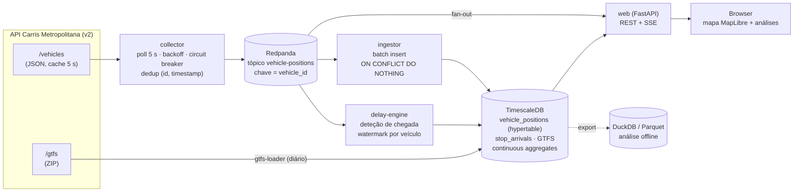

# Carris Metropolitana — Live

Pipeline de dados **em tempo real** sobre a rede de autocarros da
[Carris Metropolitana](https://www.carrismetropolitana.pt) (Área Metropolitana de
Lisboa), feita com dados abertos: posições dos veículos em tempo real e horários GTFS.

O que o sistema faz:

1. **Recolhe** as posições de todos os autocarros a cada 5 s e publica-as num log de eventos.
2. **Persiste** o stream numa base de séries temporais, de forma idempotente.
3. **Compara** cada passagem por uma paragem com o horário GTFS e calcula o **atraso por paragem**.
4. **Mostra** um mapa ao vivo (SSE) com os veículos em movimento, coloridos pelo atraso.
5. **Agrega**, de forma incremental, os atrasos por linha, hora do dia e dia da semana.

> **Estado:** em desenvolvimento. O plano está em [`docs/PLANO.md`](docs/PLANO.md) e a
> investigação da API em [`docs/API.md`](docs/API.md).

---

## Arquitetura



### Porquê esta stack

| Peça | Escolha | Razão |
|---|---|---|
| Linguagem | **Python 3.12+** com `uv` | Ecossistema de dados, `asyncio` para I/O |
| Log de eventos | **Redpanda** (API Kafka) | Replay, partições por veículo (ordem garantida por chave), vários consumidores independentes. Um único binário, sem ZooKeeper |
| Séries temporais | **TimescaleDB** (Postgres) | Hypertables, *continuous aggregates* (agregação **incremental** nativa), SQL normal para os *joins* com o GTFS |
| Análise offline | **DuckDB** | Ler Parquet exportado; notebooks rápidos sem carregar a BD |
| Web | **FastAPI** + **SSE** | O mapa só recebe dados do servidor, por isso SSE chega e é mais simples que WebSocket: reconexão automática e passa por proxies HTTP |
| Mapa | **MapLibre GL JS** + tiles OSM | Open-source, WebGL e sem chave de API |
| Testes | `pytest`, `hypothesis`, `respx` | Propriedades de idempotência e ordem; mock HTTP |

### Garantias de entrega e tratamento de falhas

| Falha | Tratamento |
|---|---|
| API em baixo, timeout ou 5xx | Retry com backoff exponencial e jitter; *circuit breaker* abre após N falhas e a métrica `source_up=0` fica exposta. Um **404 com `[]`** também conta como falha (é o comportamento real do servidor com a cache vazia) |
| Resposta repetida (cache de 5 s) | O coletor só emite um evento quando o `timestamp` do veículo avança |
| Duplicados no log (retry do produtor, reprocessamento) | `UNIQUE (vehicle_id, ts)` + `ON CONFLICT DO NOTHING`: a ingestão é idempotente |
| Eventos fora de ordem | Partição por `vehicle_id` mantém a ordem por veículo no log. No *delay-engine*, um *watermark* por veículo com tolerância configurável descarta (e regista) eventos atrasados |
| Crash do consumidor | Offset só é *commitado* depois do *commit* na BD: *at-least-once* + idempotência ⇒ sem perdas nem duplicados |
| Unidade do timestamp ambígua (s vs ms) | Normalizada na entrada (ver [`docs/API.md`](docs/API.md)) |

### Cálculo do atraso

Um veículo "chega" a uma paragem quando o seu `stop_id` muda ou passa a
`STOPPED_AT`. Como reforço, usa-se uma *geofence* de 40 m à volta da paragem. O
instante observado é comparado com o `arrival_time` do GTFS para o par
(`trip_id`, `stop_id`), no **dia de serviço** correto. No GTFS, as horas podem
passar das 24:00: `25:10:00` significa 01:10 do dia seguinte.

```
delay_s = observed_arrival − (service_date + arrival_time)
```

A validação faz-se contra o endpoint oficial `/v2/arrivals/by_stop/:id`, que
publica o `observed_arrival` da própria Carris.

---

## Volume de dados e latência

> Por medir. Os números vão ser obtidos com o sistema a correr contra a API real
> (`make bench`) e publicados aqui. Não vou pôr estimativas no lugar de medições.

| Métrica | Valor |
|---|---|
| Veículos ativos (pico / vazio) | — |
| Eventos novos / s (após dedup) | — |
| Linhas em `vehicle_positions` / dia | — |
| Espaço em disco / dia (comprimido) | — |
| Latência p50 / p95: posição do veículo → browser | — |

## Capturas de ecrã

*(a adicionar: mapa ao vivo, heatmap hora × dia da semana, ranking de linhas)*

---

## Correr localmente

```bash
docker compose up -d       # redpanda, timescaledb, collector, ingestor, delay-engine, web
open http://localhost:8000 # mapa ao vivo
```

## Licença e dados

Código sob licença MIT. Os dados (GTFS e tempo real) são da Carris Metropolitana
e estão publicados sob [CC BY 4.0](https://github.com/carrismetropolitana/gtfs/blob/HEAD/LICENSE).
Fonte: Carris Metropolitana.
