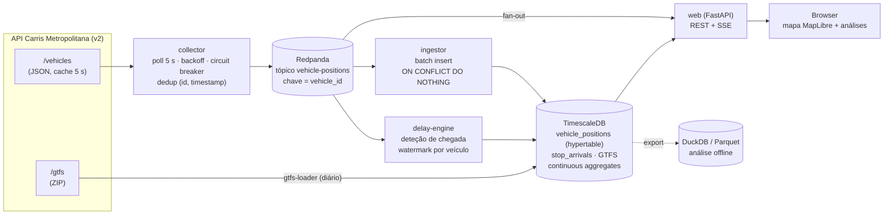

# Carris Metropolitana — Live

Pipeline de dados **em tempo real** sobre a rede de autocarros da
[Carris Metropolitana](https://www.carrismetropolitana.pt) (Área Metropolitana de
Lisboa), feita com dados abertos: posições dos veículos em tempo real e horários GTFS.

O que o sistema faz:

1. **Recolhe** as posições de todos os autocarros a cada 5 s e publica-as num log de eventos.
2. **Persiste** o stream numa base de séries temporais, de forma idempotente.
3. **Compara** cada passagem por uma paragem com o horário GTFS e calcula o **atraso por paragem**.
4. **Mostra** um mapa ao vivo (SSE) com os veículos em movimento, coloridos pelo atraso.
5. **Agrega**, de forma incremental, os atrasos por linha, hora do dia e dia da semana.

> **Estado:** pipeline completa e testada ponta a ponta contra TimescaleDB e Redpanda
> reais. Faltam as medições de volume e latência e as capturas de ecrã com dados ao vivo
> (ver [Volume de dados e latência](#volume-de-dados-e-latência)). Plano em
> [`docs/PLANO.md`](docs/PLANO.md); investigação da API em [`docs/API.md`](docs/API.md).

---

## Arquitetura



### Porquê esta stack

| Peça | Escolha | Razão |
|---|---|---|
| Linguagem | **Python 3.12+** com `uv` | Ecossistema de dados, `asyncio` para I/O |
| Log de eventos | **Redpanda** (API Kafka) | Replay, partições por veículo (ordem garantida por chave), vários consumidores independentes. Um único binário, sem ZooKeeper |
| Séries temporais | **TimescaleDB** (Postgres) | Hypertables, *continuous aggregates* (agregação **incremental** nativa), SQL normal para os *joins* com o GTFS |
| Análise offline | **DuckDB** | Ler Parquet exportado; notebooks rápidos sem carregar a BD |
| Web | **FastAPI** + **SSE** | O mapa só recebe dados do servidor, por isso SSE chega e é mais simples que WebSocket: reconexão automática e passa por proxies HTTP |
| Mapa | **MapLibre GL JS** + tiles OSM | Open-source, WebGL e sem chave de API |
| Testes | `pytest`, `hypothesis`, `respx` | Propriedades de idempotência e ordem; mock HTTP |

### Garantias de entrega e tratamento de falhas

| Falha | Tratamento |
|---|---|
| API em baixo, timeout ou 5xx | Retry com backoff exponencial e jitter; *circuit breaker* abre após N falhas e a métrica `source_up=0` fica exposta. Um **404 com `[]`** também conta como falha (é o comportamento real do servidor com a cache vazia) |
| Resposta repetida (cache de 5 s) | O coletor só emite um evento quando o `timestamp` do veículo avança |
| Duplicados no log (retry do produtor, reprocessamento) | `UNIQUE (vehicle_id, ts)` + `ON CONFLICT DO NOTHING`: a ingestão é idempotente |
| Eventos fora de ordem | Partição por `vehicle_id` mantém a ordem por veículo no log. No *delay-engine*, um *watermark* por veículo com tolerância configurável descarta (e regista) eventos atrasados |
| Crash do consumidor | Offset só é *commitado* depois do *commit* na BD: *at-least-once* + idempotência ⇒ sem perdas nem duplicados |
| Unidade do timestamp ambígua (s vs ms) | Normalizada na entrada (ver [`docs/API.md`](docs/API.md)) |

### Cálculo do atraso

Um veículo "chega" a uma paragem quando o seu `stop_id` muda ou passa a
`STOPPED_AT`. Como reforço, usa-se uma *geofence* de 40 m à volta da paragem. O
instante observado é comparado com o `arrival_time` do GTFS para o par
(`trip_id`, `stop_id`), no **dia de serviço** correto. No GTFS, as horas podem
passar das 24:00: `25:10:00` significa 01:10 do dia seguinte.

```
delay_s = observed_arrival − (service_date + arrival_time)
```

A validação faz-se contra o endpoint oficial `/v2/arrivals/by_stop/:id`, que
publica o `observed_arrival` da própria Carris.

---

## Volume de dados e latência

### Medido

| O quê | Valor | Como |
|---|---|---|
| Feed GTFS (plano de jun/2024, histórico do repositório oficial) | 250 090 viagens · 7 905 351 `stop_times` · 12 527 paragens · 1 046 rotas | `python -m cmlive gtfs --zip …` |
| Carregamento do GTFS completo (zip → COPY → índices → troca atómica) | **56,5 s**; 978 MB em `gtfs.stop_times` | VM de desenvolvimento na cloud |
| Recarregar o mesmo feed | 0,5 s (sha256 igual ⇒ não faz nada) | |

### Por medir com a API ao vivo

Estes números dependem da API real e só são publicados quando forem medidos
(`make bench` → `/api/stats`, e o histograma `cm_e2e_latency_seconds` em `/metrics`).
Não vou pôr estimativas no lugar de medições.

| Métrica | Valor |
|---|---|
| Veículos ativos (pico / vazio) | — |
| Eventos novos / s (após dedup) | — |
| Linhas em `vehicle_positions` / dia e espaço comprimido | — |
| Latência p50 / p95 por etapa: veículo → coletor → log → BD → browser | — |

A latência é decomposta por etapa porque cada uma tem um dono diferente:

```
ts (veículo)  →  collected_at (coletor)  →  log_ts (Redpanda)  →  ingested_at (BD)  →  browser
 └─ fonte: hub GO + cache de 5 s da API ─┘└──────────── esta pipeline ─────────────┘
```

## Capturas de ecrã

*(a adicionar com dados reais: `uv run --with playwright python scripts/screenshots.py`
gera `docs/img/map.png` e `docs/img/analytics.png`)*

---

## Correr localmente

Requisitos: Docker e acesso à Internet (a `api.carrismetropolitana.pt` e aos tiles do OpenStreetMap).

```bash
docker compose up -d --build   # redpanda, timescaledb, gtfs, collector, ingestor, delay-engine, web
docker compose logs -f gtfs    # 1.ª vez: descarrega e carrega o GTFS (~1 min)
open http://localhost:8000     # mapa ao vivo
open http://localhost:8000/analytics
```

| Serviço | O que faz |
|---|---|
| `collector` | Polling de `/v2/vehicles` a cada 5 s → tópico `vehicle-positions` (chave = veículo). Métricas em `:9100` |
| `ingestor` | Tópico → `vehicle_positions` em lotes, idempotente |
| `delay-engine` | Tópico → deteção de chegadas → `stop_arrivals` + tópico `stop-arrivals` |
| `gtfs` | Carrega o GTFS (só se mudou). Para um ficheiro local: `CMLIVE_GTFS_ZIP=/data/gtfs.zip` |
| `web` | Mapa (SSE), análises, `/api/*`, `/metrics` |
| `prometheus` | Opcional: `docker compose --profile observability up -d` |

Outras ferramentas:

```bash
CMLIVE_RECORD_DIR=/data/recordings docker compose up -d collector  # grava as respostas em bruto
uv run python -m cmlive replay data/recordings --speed 20           # volta a injetá-las no log
uv run --extra analytics python -m cmlive export --days 7           # Parquet para DuckDB
```

## Testes

```bash
make test        # 61 testes unitários e de propriedades (sem dependências externas)
make up-infra    # TimescaleDB + Redpanda
make test-all    # + teste ponta a ponta contra a infraestrutura real
```

O que é testado:

- **Normalização da fonte**: timestamp em s *e* ms, nulos, coordenadas trocadas ou (0,0), posições velhas ou no futuro.
- **Falhas da API**: 5xx, timeouts, 404 com `[]`, HTML em vez de JSON; retry com backoff e *circuit breaker* (abre, sonda, fecha).
- **Duplicados e ordem**: testes de propriedades (Hypothesis) mostram que baralhar e duplicar eventos dentro da janela não muda as chegadas detetadas.
- **Tempo GTFS**: horas > 24:00, dia de serviço anterior, linhas circulares e dias de mudança de hora. Este teste apanhou um bug real: somar `timedelta` a um `datetime` com fuso dava um erro de 1 h nesses dias.
- **Ponta a ponta** (CI com TimescaleDB e Redpanda reais): uma viagem real do GTFS com trajetória sintética (+120 s, 30% duplicados, fora de ordem) dá exatamente uma chegada por paragem com atraso de 120 s; reprocessar o mesmo stream não cria linhas; o *continuous aggregate* e a API refletem os dados.

O sistema também foi corrido com `docker compose` num ambiente **sem acesso** à API. O
coletor fez os retries, abriu o *circuit breaker* ao fim de 5 falhas e expôs
`cm_source_up 0`, enquanto o resto da stack continuou de pé.

## Licença e dados

Código sob licença MIT. Os dados (GTFS e tempo real) são da Carris Metropolitana
e estão publicados sob [CC BY 4.0](https://github.com/carrismetropolitana/gtfs/blob/HEAD/LICENSE).
Fonte: Carris Metropolitana.
