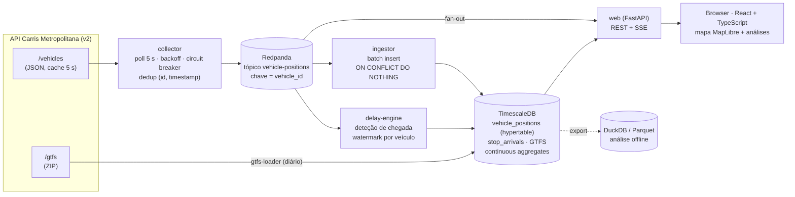
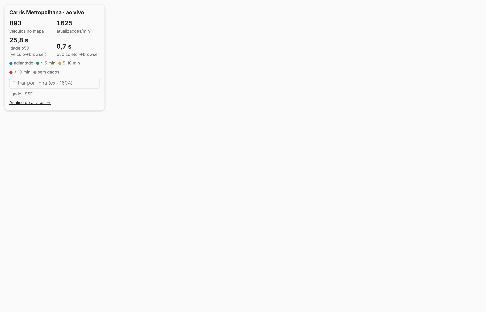
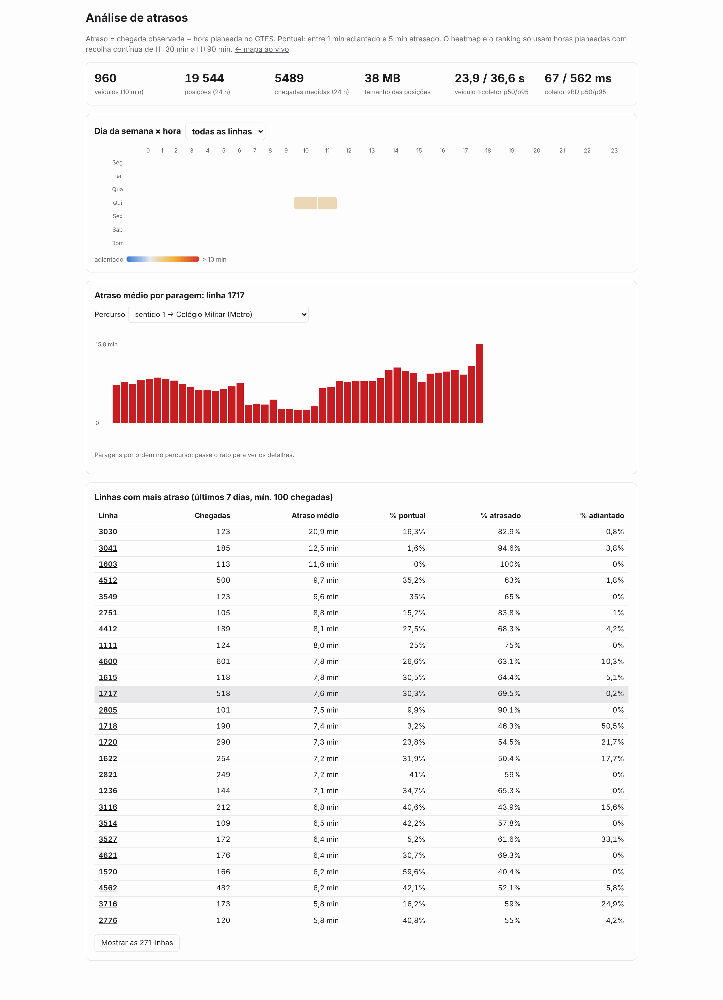

# Carris Metropolitana — Live

Pipeline de dados **em tempo real** sobre a rede de autocarros da
[Carris Metropolitana](https://www.carrismetropolitana.pt) (Área Metropolitana de
Lisboa), feita com dados abertos: posições dos veículos em tempo real e horários GTFS.

O que o sistema faz:

1. **Recolhe** as posições de todos os autocarros a cada 5 s e publica-as num log de eventos.
2. **Persiste** o stream numa base de séries temporais, de forma idempotente.
3. **Compara** cada passagem por uma paragem com o horário GTFS e calcula o **atraso por paragem**.
4. **Mostra** um mapa ao vivo (SSE) com os veículos em movimento, coloridos pelo atraso.
5. **Agrega**, de forma incremental, os atrasos por linha, hora do dia e dia da semana.

> **Estado:** pipeline completa, testada ponta a ponta e corrida contra a **API real**
> (ver [números medidos](#volume-de-dados-e-latência)). As diferenças entre a documentação
> da API e a realidade, e como foram tratadas, estão em [`docs/API.md`](docs/API.md).
> Plano em [`docs/PLANO.md`](docs/PLANO.md).

---

## Arquitetura



### Porquê esta stack

| Peça | Escolha | Razão |
|---|---|---|
| Linguagem | **Python 3.12+** com `uv` | Ecossistema de dados, `asyncio` para I/O |
| Log de eventos | **Redpanda** (API Kafka) | Replay, partições por veículo (ordem garantida por chave), vários consumidores independentes. Um único binário, sem ZooKeeper |
| Séries temporais | **TimescaleDB** (Postgres) | Hypertables, *continuous aggregates* (agregação **incremental** nativa), SQL normal para os *joins* com o GTFS |
| Análise offline | **DuckDB** | Ler Parquet exportado; notebooks rápidos sem carregar a BD |
| Web | **FastAPI** + **SSE** | O mapa só recebe dados do servidor, por isso SSE chega e é mais simples que WebSocket: reconexão automática e passa por proxies HTTP |
| Frontend | **React 18 + TypeScript** (Vite) | SPA com duas páginas; TypeScript estrito com tipos espelhados da API; o mapa é carregado *lazy* (a página de análise pesa 57 kB gzip) |
| Mapa | **MapLibre GL JS** + tiles OSM | Open-source, WebGL e sem chave de API: 1 000+ pontos animados numa camada WebGL, sem DOM |
| Testes | `pytest`, `hypothesis`, `respx` | Propriedades de idempotência e ordem; mock HTTP |

### Garantias de entrega e tratamento de falhas

| Falha | Tratamento |
|---|---|
| API em baixo, timeout ou 5xx | Retry com backoff exponencial e jitter; *circuit breaker* abre após N falhas e a métrica `source_up=0` fica exposta. Um **404 com `[]`** também conta como falha (é o comportamento real do servidor com a cache vazia) |
| Resposta repetida (cache de 5 s) | O coletor só emite um evento quando o `timestamp` do veículo avança |
| Duplicados no log (retry do produtor, reprocessamento) | `UNIQUE (vehicle_id, ts)` + `ON CONFLICT DO NOTHING`: a ingestão é idempotente |
| Eventos fora de ordem | Partição por `vehicle_id` mantém a ordem por veículo no log. No *delay-engine*, um *watermark* por veículo com tolerância configurável descarta (e regista) eventos atrasados |
| Crash do consumidor | Offset só é *commitado* depois do *commit* na BD: *at-least-once* + idempotência ⇒ sem perdas nem duplicados |
| Unidade do timestamp ambígua (s vs ms) | Normalizada na entrada (ver [`docs/API.md`](docs/API.md)) |

### Cálculo do atraso

Um veículo "chega" a uma paragem quando o seu `stop_id` muda ou passa a
`STOPPED_AT`. Como reforço, usa-se uma *geofence* de 40 m à volta da paragem. O
instante observado é comparado com o `arrival_time` do GTFS para o par
(`trip_id`, `stop_id`), no **dia de serviço** correto. No GTFS, as horas podem
passar das 24:00: `25:10:00` significa 01:10 do dia seguinte.

```
delay_s = observed_arrival − (service_date + arrival_time)
```

A validação faz-se contra o endpoint oficial `/v2/arrivals/by_stop/:id`, que
publica o `observed_arrival` da própria Carris.

---

## Volume de dados e latência

Medido contra a **API real** em duas janelas de recolha, com o GTFS em vigor
(`feed_version 20261104-0400-05`):

| Janela | Período (Lisboa) | Duração |
|---|---|---|
| 1 | qua 04/11, 17:16–17:56 (ponta da tarde) | 0,7 h |
| 2 | qui 05/11, 09:21–12:50 (fim da ponta da manhã → vazio) | 3,5 h |

As tabelas de atrasos abaixo são geradas por `python -m cmlive report` a partir da BD.

### Volume

| Métrica | Valor medido |
|---|---|
| Veículos distintos | 1 563 no total; 1 059–1 414 por hora |
| Eventos novos após dedup | 69,6 /s (qua 17 h) · 65,3 /s (qui 9 h) · 45,7–53,2 /s (qui 10–12 h) |
| Registos repetidos descartados pelo coletor | **67%** (1,39 M repetidos vs. 675 k novos, só na janela 2) |
| Polls na janela 2 | 2 500/2 500 bem-sucedidos (intervalo de 5 s), 0 reinícios em 3,5 h |
| Intervalo entre posições do mesmo veículo | p50 15 s · p90 23 s (janela 2) |
| Posições rejeitadas | 4 980 com coordenadas `(0, 0)` (0,7%) |
| Espaço em `vehicle_positions` | 3,5 h = 675 k posições: 233 MB → **22 MB comprimido** (10,6×, ~35 B/posição) |
| Totais | 846 k posições · 163 k chegadas · 6 891 viagens · 593 linhas |
| Chegadas com horário GTFS correspondente | **99,9%** das chegadas detetadas (100 sem correspondência em 134 k na janela 2) |
| GTFS em vigor | 306 978 viagens · 9 955 081 `stop_times` · 12 797 paragens; carregado em 69–80 s (com download) |

### Latência ponta a ponta

Medida na BD (675 k posições da janela 2) e no browser (8 010 amostras de *deltas* SSE, sem contar o snapshot inicial):

| Etapa | p50 | p95 | Onde |
|---|---|---|---|
| veículo → coletor (idade ao chegar à API) | 20,6 s | 29,9 s | fonte: hub GO + cache de 5 s da API |
| coletor → BD (Redpanda + ingestor) | 71 ms | 129 ms | esta pipeline (p99 170 ms) |
| log (Redpanda) → browser | 0,75 s | 1,68 s | esta pipeline (inclui o *tick* SSE de 1 s) |
| coletor → browser | **0,77 s** | **1,75 s** | esta pipeline |
| **veículo → browser** | **20,8 s** | **29,5 s** | total |
| chegada observada → `stop_arrivals` | 46 s | 54 s | idade na fonte + janela de reordenação (20 s) + ponto médio entre observações |

```
ts (veículo) ──20,6 s──▶ collected_at ──~0,07 s──▶ BD
                                     └──~0,75 s──▶ browser
 └──── fonte (fora do nosso controlo) ────┘└──── esta pipeline: p95 < 1,8 s ────┘
```

Quase toda a latência está **a montante** da API. Do que é nosso, a maior parte é o
*tick* SSE de 1 s, uma escolha deliberada: agrupa ~50–70 atualizações/s numa mensagem
por segundo.

### Atrasos

**Só horas planeadas com cobertura completa.** Uma hora planeada H só entra se a recolha
esteve ativa, sem falhas, de H − 30 min a H + 90 min. Nos dados recolhidos, p1 = −11 min e
p99 = +24 min, e só 0,5% das chegadas ficam a mais de 30 min do horário, por isso essa
janela apanha mais de 99,5% das chegadas. Sem este filtro, as pontas da recolha só
apanham as viagens mais atrasadas (ou adiantadas). Com 3,5 h contínuas, há **duas
horas** com cobertura completa:

| Hora planeada | Chegadas | Média | p50 | p90 | % pontual (−1 a +5 min) |
|---|---|---|---|---|---|
| qui 05/11 10 h | 38 736 | 1,6 min | 1,0 min | 8,2 min | 51,8% |
| qui 05/11 11 h | 33 425 | 1,5 min | 1,0 min | 7,5 min | 54,5% |

**Linhas com mais atraso** (≥ 200 chegadas nessas horas):

| Linha | Chegadas | Média | % pontual |
|---|---|---|---|
| 4512 | 500 | 9,7 min | 35,2% |
| 4600 | 601 | 7,8 min | 26,6% |
| 1717 | 518 | 7,6 min | 30,3% |
| 1720 | 290 | 7,3 min | 23,8% |
| 1622 | 254 | 7,2 min | 31,9% |

**Linhas mais pontuais** (≥ 200 chegadas): 1229 (99,6% pontual), 1120 (92,9%), 1617 (88,4%), 2710 (87,7%), 1606 (87,4%).

**Métodos de deteção** (163 k chegadas): `stopped` 35,6% · `passed` 33,6% · `geofence` 28,2% ·
`departed` 2,6%. A incerteza média é de 8–9 s em todos os métodos, e as medianas de
atraso são parecidas entre eles (1,0–1,7 min), o que sugere que nenhum método está
enviesado de forma grosseira.

### O que estes dados mostram (e os seus limites)

- A linha **1717** aparece entre as mais atrasadas nas duas janelas. Na quarta à tarde,
  o sentido Colégio Militar chegou a 37 min de atraso. Na quinta de manhã, o atraso
  cresce ao longo do percurso até ~20 min no fim (captura abaixo).
- Na chegada ao terminal há linhas com forte **adiantamento** na última paragem
  (ex.: 4321): é típico de horários com folga no fim do percurso.
- **4,2 horas não são um estudo.** Para comparar horas do dia e dias da semana são
  precisos vários dias completos. O sistema já está preparado para isso; o *heatmap*
  e o ranking da página web aplicam o mesmo filtro de cobertura.
- **Validação oficial:** `cmlive validate` consultou `/v2/arrivals/by_stop` para as 50
  paragens com mais chegadas. A API não publicou **nenhum** `observed_arrival` (0 em
  2 205 registos; só estimativas para chegadas futuras), por isso a comparação com a
  verdade oficial fica pendente.

## Capturas de ecrã

Dados reais, qui 05/11/2026, ~12:55 (Lisboa).

**Mapa ao vivo:** veículos coloridos pelo último atraso medido (cinzento = ainda sem chegada medida).



**Análise:** KPIs, *heatmap* (só as horas com cobertura completa), atraso por paragem
(linha 1717, sentido Colégio Militar) e ranking de linhas.



---

## Correr localmente

Requisitos: Docker e acesso à Internet (a `api.carrismetropolitana.pt` e aos tiles do OpenStreetMap).

```bash
docker compose up -d --build   # redpanda, timescaledb, gtfs, collector, ingestor, delay-engine, web
docker compose logs -f gtfs    # 1.ª vez: descarrega e carrega o GTFS (~1 min)
open http://localhost:8000     # mapa ao vivo
open http://localhost:8000/analytics
```

| Serviço | O que faz |
|---|---|
| `collector` | Polling de `/v2/vehicles` a cada 5 s → tópico `vehicle-positions` (chave = veículo). Métricas em `:9100` |
| `ingestor` | Tópico → `vehicle_positions` em lotes, idempotente |
| `delay-engine` | Tópico → deteção de chegadas → `stop_arrivals` + tópico `stop-arrivals` |
| `gtfs` | Carrega o GTFS (só se mudou). Para um ficheiro local: `CMLIVE_GTFS_ZIP=/data/gtfs.zip` |
| `web` | Frontend React (mapa e análises), `/api/*` (REST + SSE), `/metrics` |
| `prometheus` | Opcional: `docker compose --profile observability up -d` |

Outras ferramentas:

```bash
CMLIVE_RECORD_DIR=/data/recordings docker compose up -d collector  # grava as respostas em bruto
uv run python -m cmlive replay data/recordings --speed 20           # volta a injetá-las no log
uv run --extra analytics python -m cmlive export --days 7           # Parquet para DuckDB
uv run python -m cmlive validate --stops 50                         # erro vs. observed_arrival oficial
uv run python -m cmlive report                                      # tabelas do README a partir da BD
```

## Frontend

`frontend/` é uma SPA em React + TypeScript (Vite), servida pelo FastAPI a partir do
*build* (`src/cmlive/web/dist`, gerado no Docker num estágio Node).

```
frontend/src/
├── api/        tipos espelhados do JSON do backend + cliente com cancelamento
├── live/       Fleet (estado da frota, fora do React) + useLiveFleet (SSE)
├── lib/        classificação/cores dos atrasos, quantis, useAsync
├── components/ MapView, LivePanel, Heatmap, StopChart, LinesTable, KpiRow
└── pages/      LivePage (/) e AnalyticsPage (/analytics)
```

Decisões que vale a pena explicar:

- **O estado da frota vive fora do React** (`live/fleet.ts`). O mapa anima mais de 1 000
  veículos e o React só recebe contadores uma vez por segundo, por isso não há
  *re-renders* por cada posição.
- **O mapa só envia dados ao MapLibre quando é preciso,** no máximo a 20 fps. Cada
  `setData` reprocessa o GeoJSON todo num *worker*. A 60 fps, isso ocupava **25%** da
  *thread* principal e atrasava a navegação **5,8 s**; com o limite e sem redesenhos
  quando nada muda, passou para **4%** e **1,0 s** (medido com Chromium sem GPU, via CDP).
- **O snapshot inicial não conta como latência,** só os *deltas*. Se contasse, media-se
  a idade do snapshot, que pode chegar a 5 min.
- **Popups construídos em DOM** (`textContent`), não com HTML em string: os dados vindos da
  API nunca são interpretados como HTML (há um teste para isso).
- **Pedidos canceláveis** (`AbortController`): ao trocar de linha, uma resposta antiga
  nunca se sobrepõe à nova.

```bash
cd frontend
npm ci
npm run dev        # Vite em :5173, com proxy de /api para o backend em :8000
npm test           # Vitest + Testing Library
npm run e2e        # Playwright sobre o build, com a API simulada
```

## Testes

```bash
make test        # 73 testes Python, unitários e de propriedades (sem dependências externas)
make test-front  # frontend: typecheck, lint, 45 testes Vitest e 2 smoke tests Playwright
make up-infra    # TimescaleDB + Redpanda
make test-all    # + teste ponta a ponta contra a infraestrutura real
```

O que é testado:

- **Normalização da fonte**: timestamp em s *e* ms, nulos, coordenadas trocadas ou (0,0), posições velhas ou no futuro.
- **Falhas da API**: 5xx, timeouts, 404 com `[]`, HTML em vez de JSON; retry com backoff e *circuit breaker* (abre, sonda, fecha).
- **Duplicados e ordem**: testes de propriedades (Hypothesis) mostram que baralhar e duplicar eventos dentro da janela não muda as chegadas detetadas.
- **Tempo GTFS**: horas > 24:00, dia de serviço anterior, linhas circulares e dias de mudança de hora. Este teste apanhou um bug real: somar `timedelta` a um `datetime` com fuso dava um erro de 1 h nesses dias.
- **Frontend**: regras do estado da frota (o snapshot não conta como latência, posições
  antigas ignoradas, interpolação), escalas de cor e fronteiras de "pontual", o *hook* SSE
  com um `EventSource` simulado, componentes com Testing Library (teclado, seleção,
  expansão do ranking), a página de análise com `fetch` simulado (incluindo erro 503), e a
  ausência de injeção de HTML nos popups. O Playwright abre o *build* real num Chromium,
  com a API e a stream SSE simuladas.
- **Ponta a ponta** (CI com TimescaleDB e Redpanda reais): uma viagem real do GTFS com trajetória sintética (+120 s, 30% duplicados, fora de ordem) dá exatamente uma chegada por paragem com atraso de 120 s; reprocessar o mesmo stream não cria linhas; o *continuous aggregate* e a API refletem os dados.

Antes de o domínio da API estar autorizado, o sistema também foi corrido com
`docker compose` num ambiente **sem acesso** à API. O
coletor fez os retries, abriu o *circuit breaker* ao fim de 5 falhas e expôs
`cm_source_up 0`, enquanto o resto da stack continuou de pé.

## Licença e dados

Código sob licença MIT. Os dados (GTFS e tempo real) são da Carris Metropolitana
e estão publicados sob [CC BY 4.0](https://github.com/carrismetropolitana/gtfs/blob/HEAD/LICENSE).
Fonte: Carris Metropolitana.
